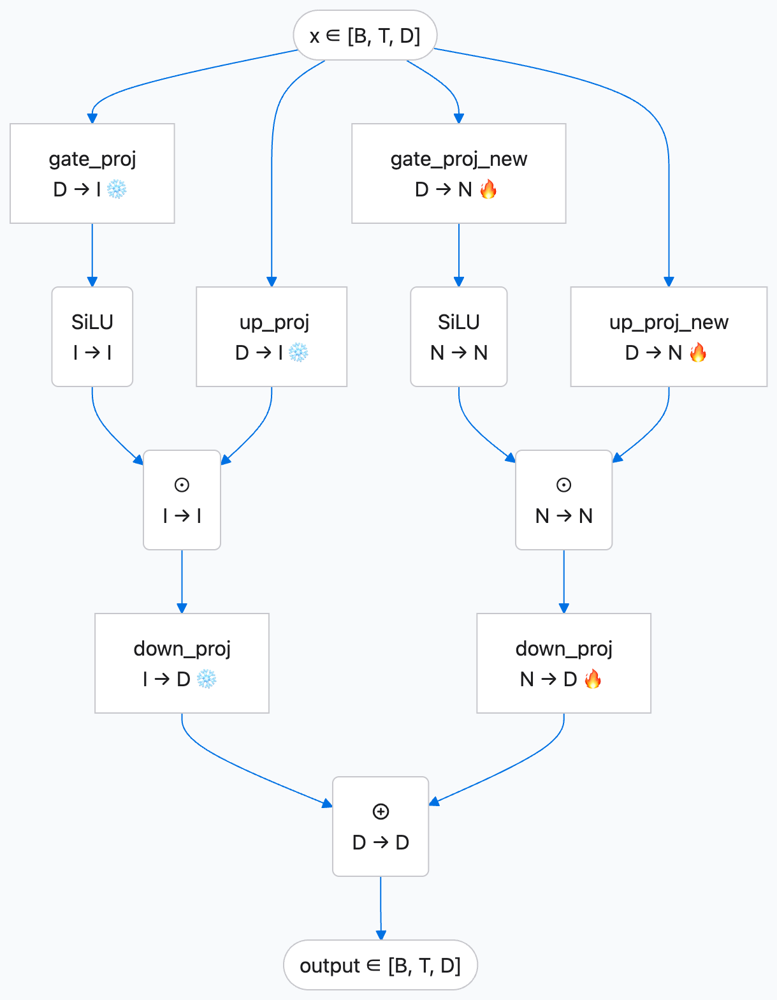

# Kadllm

**From understanding users to generating recommendations: LLM4Rec at Kuaishou E-commerce Advertising.**

English | [简体中文](README.zh-CN.md)

We are the **E-commerce Advertising Retrieval Team at Kuaishou**. We are exploring how to bring the world knowledge, semantic understanding and heterogeneous information modeling capabilities of large language models into advertising recommendation: understanding users' long-term interests and deeper needs, directly generating relevant ad candidates, and doing so within practical production latency and cost budgets.

**Kadllm shares the core model components from this LLM4Rec effort with the community.** It packages our **WideTuning adaptation method** and **GRBeam shared-prefix inference kernels for generative retrieval** as independently usable components, helping developers adapt pretrained language models to recommendation and reduce the engineering effort required to serve them.

## Why use language models for recommendation?

Generative retrieval represents an ad or product as a short semantic identifier (SID). A model can then generate identifiers conditioned on user information, much as a language model generates text. We investigate two routes toward this goal: generative recommenders trained from scratch primarily on user behavior, and **LLM4Rec**, which adapts a pretrained language model to recommendation.

Our investment in LLM4Rec is motivated by two opportunities.

First, **recommendation can draw on knowledge beyond interaction logs.** A language model's existing knowledge and semantic capabilities provide a foundation for understanding products, content and shopping intent. Adding commerce-domain knowledge offers a way to improve recommendations for mid- and long-tail users and ads, where interaction evidence is relatively sparse. Our earlier two-stage Align3GR work provided practical evidence of the value of this direction in those settings.

Second, **user interests can be represented through longer histories and more sources of evidence.** Profiles, content preferences, cart and purchase histories, and heterogeneous behaviors can reveal interests that ad clicks alone do not capture. LLM4Rec provides a shared modeling space for these signals, offering an opportunity to reduce dependence on a single advertising-interaction feedback loop.

In our work, behavior-based generative recommendation and LLM4Rec are complementary. This project aims to build an **LLM4Rec foundation for e-commerce advertising** that combines general knowledge, commerce knowledge and user behavior—and to evaluate its usefulness in a real retrieval system.

## Bridging the gap between generation and production

Connecting recommendation data to a language model is only the beginning. Production use exposed four connected challenges: learning many new SIDs without unnecessarily disrupting existing capabilities, identifying useful commerce knowledge, integrating heterogeneous user evidence, and making inference affordable enough to deploy.

The wider project investigates SID–text alignment, collaborative and commerce knowledge, a Token Factory that compresses heterogeneous evidence into soft tokens, and specialized serving for short outputs. **Kadllm shares two components that developers can use independently to train models for recommendation and accelerate inference.**

### WideTuning: mitigate catastrophic forgetting during SID adaptation



Learning new SID tokens, semantic mappings and recommendation associations can cause catastrophic forgetting. WideTuning is designed to mitigate this problem: it freezes the original FFN branches and adds independently trainable channels for new knowledge, balancing SID alignment with general capability retention.

WideTuning extends a language model's gated feed-forward layers with additional trainable channels. The original branch stays frozen while the new branch learns task information. Zero initialization of the added output projection preserves the initial function. After training, both branches can be merged into a conventional wider dense MLP without an additional expert router.

Developers can install the expansion on an existing model, train the added parameters independently, and merge for deployment. The tables below evaluate SID alignment and general capability retention separately across adaptation methods. Frozen base weights alone do not guarantee unchanged capabilities after training.

### GRBeam: hundreds of candidates, one shared long context

Generative retrieval has a distinctive workload: **short outputs, many candidates.** An SID may contain only two or three tokens, yet a retrieval request may need hundreds of candidate beams. On models combining linear and full attention, maintaining, copying and reordering state for each beam can impose substantial memory and execution costs.

Our approach computes and stores the long prefix once, sharing that immutable state across beams. Each beam replays its own short generated suffix during decoding. GRBeam supports this execution pattern with Triton gated-delta and causal-convolution kernels and optional FlashAttention, with further optimizations for grouped prefix reuse and terminal computation.

With random Qwen3.5-0.8B weights, BF16, batch 32, prefix length 1024, beam width 256, three output tokens and the full vocabulary, GRBeam reaches **16.94 requests/s on a single RTX 4090 and 36.08 requests/s on a single H800**. In a separate two-level conditional-SID experiment, grouped kernel optimization reduces batch latency by another **6.6–10.4%** over the original defaults at batch ≥ 8. Detailed comparisons and measurement conditions appear below; these workload-specific performance results do not establish recommendation quality for random models.

## What did the wider project achieve?

The complete application combines model adaptation, heterogeneous features and inference optimization, integrating SID generation and vector retrieval as complementary candidate sources.

- **Offline retrieval:** Semantic and domain pretraining followed by SFT improves full-SID Hit@128 from **0.110 to 0.304**. In a separate series, adding user summaries and commerce histories improves the metric from **0.288 to 0.335**.
- **Production throughput:** A 1.06B model, 400–5,000 input tokens and beam schedule [256, 256, 512] achieve **340 aggregate requests/s across eight RTX 4090 GPUs**.
- **Online impact:** A seven-day A/B experiment reports **+0.961% advertising spend in the target e-commerce advertising scope** and **+0.427% across the advertising platform**.

These are experimental and operational results for the integrated application, including data, features and serving optimizations beyond this repository. They cannot all be attributed to an individual module. They demonstrate the practical value of developing language-model adaptation, user representation and specialized inference together.

## What are we sharing?

Kadllm provides independently usable **WideTuning modules, GRBeam shared-prefix inference operators, model adapters and benchmark scripts**. Use WideTuning to add capacity to your own gated MLP, or use the inference kernels to explore performance across batch sizes, beam widths, sequence lengths and backend combinations.

We hope these components, developed around real production problems, help others explore LLM4Rec. We welcome evaluation and improvements across more models, hardware and recommendation tasks. The following sections cover installation, integration and reproducible performance evaluation.

---

## WideTuning benefits and adaptation comparisons

WideTuning is designed to **mitigate catastrophic forgetting during SID adaptation, learning new SID semantics while retaining pretrained general capabilities**. The two tables separately report alignment and general benchmarks. Both tables use the same WideTuning configuration.

### Alignment dataset: adaptation-method comparison

| Method | L1 R@16 | L2 R@16 | L1 R@32 | L2 R@32 | L1 R@128 | L2 R@128 |
|---|---:|---:|---:|---:|---:|---:|
| WideTuning | 0.412 | **0.123** | **0.447** | **0.141** | **0.506** | **0.174** |
| LoRA (r=32) | 0.318 | 0.068 | 0.322 | 0.071 | 0.349 | 0.075 |
| LoRA (r=64) | — | — | — | — | 0.380 | 0.101 |
| Full fine-tuning | **0.416** | 0.107 | 0.420 | 0.110 | 0.435 | 0.117 |

L1/L2 preserve the source metrics `level1_recall` / `level2_recall`; R@K means Recall@K. A dash denotes an unreported value.

### General benchmarks: capability retention after adaptation

| Model / adaptation | MMLU | C-Eval valid | HellaSwag | WinoGrande | ARC-Challenge |
|---|---:|---:|---:|---:|---:|
| Qwen3.5-0.8B (base model) | 0.482 | 0.494 | 0.389 | 0.576 | 0.333 |
| LoRA (r=32) | 0.439 | 0.408 | 0.371 | 0.569 | 0.295 |
| WideTuning | 0.484 | 0.451 | 0.393 | 0.576 | 0.340 |

The source provides no general-benchmark scores for full fine-tuning or LoRA (r=64). Neither table supplies complete training budgets, evaluation protocols or variance estimates; these are reported observations, not statistical-significance claims.

WideTuning achieves **0.174** L2 Recall@128 versus **0.075 / 0.101 / 0.117** for LoRA (r=32/r=64) and full fine-tuning. The same configuration scores **0.484** on MMLU (base: 0.482) and **0.451** on C-Eval (base: 0.494). These observations illustrate the balance between adaptation and retention, without implying unchanged performance on every capability.

The broader pretraining recipe using WideTuning reports the following offline results. These compare data and training-stage configurations, **not the three adaptation methods in isolation**:

| Hit@128 | Direct SFT | Bidirectional alignment → SFT | Alignment + collaborative relations + commerce knowledge → SFT |
|---|---:|---:|---:|
| SID level 1 | 0.392 | 0.440 | **0.557** |
| SID levels 1–2 | 0.188 | 0.255 | **0.363** |
| Full SID | 0.110 | 0.197 | **0.304** |

Full-SID Hit@128 improves by **19.4 percentage points** over direct SFT. The report does not separately attribute that improvement to WideTuning, alignment or domain tasks.

## GRBeam inference performance

**Compared with the OneLA branch, GRBeam uses less sampled whole-device memory in the full-vocabulary experiment and achieves slightly higher QPS at some shapes in the two-level SID workload requiring only one decode step.** For example, on RTX 4090 with beam 256, batch 32 and prefix 512, grouped GRBeam reaches **76.14 QPS**, versus **75.74 QPS** for the tuned OneLA branch (computed from the mean latencies below). Overall two-level SID performance is close; the small advantage does not hold at every shape. Allocated tensor-memory peaks match in that experiment, a different accounting method from the full-vocabulary whole-device measurements.

### Full-vocabulary wide-beam decoding

Identical random Qwen3.5-0.8B weights (853M total parameters including the unused vision tower), BF16, batch **32**, prefix **1024**, beam **256**, output **3**; all paths score the full **248,320-token vocabulary**. Output token one comes from prefill, followed by two decode calls.

| GPU | Path | Batch latency, seconds (95% CI) | Requests/s | Sampled device peak, GiB |
|---|---|---:|---:|---:|
| RTX 4090 | vLLM 0.19.0 native beam | 243.20 ± 9.80 | 0.13 | 20.17 |
| RTX 4090 | GRBeam, original launch defaults | 1.889 ± 0.016 | 16.94 | 9.10 |
| RTX 4090 | OneLA branch | 1.575 ± 0.112 | 20.31 | 12.59 |
| H800 | vLLM 0.19.0 native beam | 204.93 ± 7.73 | 0.16 | 65.48 |
| H800 | GRBeam, original launch defaults | 0.887 ± 0.002 | 36.08 | 9.33 |
| H800 | OneLA branch | 0.725 ± 0.002 | 44.13 | 12.82 |

Transformers 5.20.2 native beam search ran out of memory at this shape on both GPUs. Three independent processes per configuration, three warmups and five timed calls per process; confidence intervals use process means. Latency includes prefill, decode, selection, synchronization and CPU output transfer. Requests/s = batch / mean latency; this is not tokens/s or service arrival-rate capacity.

vLLM keeps compilation, CUDA graphs, chunked prefill and prefix caching enabled, with sequence/token budgets 256/8192 and a 0.8 memory-pool fraction. Cross-call cache reset is outside timing. Its 544-token hybrid-cache blocks cannot cache a complete block from a 512-token prompt. The large gap includes native beam-API resubmission and scheduling costs and is **not a general serving-framework ranking**. Sampled device memory includes reserved allocations and vLLM pools, not just live tensors.

In the 4090 factorial ablation at this shape, enabling gated-delta acceleration reduced the geometric latency ratio to **0.248** (95% CI 0.240–0.257), averaged over the other kernel switches. Convolution and attention effects were smaller and shape dependent.

OneLA denotes a branch implementation, not verified as the authors' official release. These original launch settings were not symmetrically tuned: OneLA is faster while GRBeam uses less sampled device memory, so this is not an algorithm-only ranking. At seven output tokens (batch 4, prefix 1024, beam 256), GRBeam / OneLA latency is 767 / 475 ms on 4090 and 442 / 284 ms on H800, illustrating the growing cost of suffix replay.

### Per-kernel benefits: full factorial ablation

The manuscript evaluates all 2³ combinations of GDN, convolution and attention switches. At the RTX 4090 shape above, each value is the **geometric end-to-end latency ratio with a kernel enabled versus disabled**, averaged over the other switches. These are not isolated kernel runtimes or additive gains.

| Accelerated kernel | Enabled / disabled latency ratio (95% CI) | Mean latency change | Interpretation |
|---|---:|---:|---|
| **Triton gated delta (GDN)** | **0.248 (0.240–0.257)** | **75.2% lower**, approximately 4.03× speedup | Dominant acceleration at this shape. |
| Triton causal convolution | 0.986 (0.964–1.009) | 1.4% lower | Interval includes 1; a consistent benefit is not established. |
| FlashAttention prefix/suffix attention | 1.005 (0.965–1.045) | 0.5% higher | Interval includes 1; no clear acceleration at this shape. |

Kernel selection is workload dependent; enabling every kernel is not always fastest. The benchmark supports individual switches and their combinations.

### Grouped gated-delta optimization

A separate two-level conditional-SID study uses RTX 4090, 4,096 tokens per level, beam 256 and one suffix decode. Relative to the original GRBeam defaults, grouped prefix reuse and terminal-readout factoring reduce batch latency by **6.6–10.4% at batch ≥ 8**. Selected results:

| Prefix | Batch | Original, ms | Grouped, ms (95% CI) | Tuned OneLA branch, ms (95% CI) |
|---:|---:|---:|---:|---:|
| 512 | 8 | 98.4 ± 4.4 | 89.2 ± 13.5 | 88.9 ± 10.3 |
| 512 | 32 | 461.2 ± 6.8 | 420.3 ± 20.3 | 422.5 ± 11.9 |
| 1024 | 8 | 172.9 ± 8.6 | 158.8 ± 3.9 | 161.6 ± 15.2 |
| 1024 | 32 | 772.4 ± 17.2 | 720.1 ± 26.5 | 722.7 ± 5.9 |

Three process rounds, at least 50 warmups per path, 30 interleaved timed repetitions, with launch settings selected per batch before evaluation. These conditional-SID results use a different head and scoring protocol from the full-vocabulary runner below; that runner does not reproduce this table. The kernel runner measures the underlying grouped operator, not the complete application experiment.

FP32 fixed-history comparisons in the study had maximum absolute error below **1.6e-5**. BF16 candidate sets are not identical; finite-beam pruning can amplify small score differences. Random-weight results establish execution behavior, not pretrained retrieval quality.

In the single-layer GDN microbenchmark, tuned per-beam recurrence takes **0.430 ms**, grouping and terminal factoring reduce it to **0.164 ms**, and tuned OneLA takes **0.158 ms**. Across all 16 symmetrically tuned end-to-end shapes, GRBeam ranges from 2.6% faster to 1.4% slower than OneLA; 15/16 paired 95% intervals include parity. Allocated-memory peaks match at each shape; this accounting differs from sampled whole-device memory above.

## Optimization gains reported in production

The LR also records engineering observations from the complete application serving stack. **Baselines differ or are incompletely specified; these gains are not additive and are distinct from the controlled experiments above.** The SID-only head, application trie and length scheduler belong to the wider application, not a ready-made service supplied by this library.

| Optimization | Purpose | Observation in the LR |
|---|---|---|
| Prefix-sharing Paged Attention | Share prefix KV across beams | Approximately **20× QPS** versus the report's vLLM setup, with substantially lower memory. |
| Stateless decode | Freeze request-sized KV/SSM prefixes, replay short suffixes, avoid persistent state reordering | **+10% QPS**; memory reduction written as “30G” (GB/GiB and accounting scope unspecified). |
| SID-only LM head | Project only to SID tokens, less than 9% of the full vocabulary | **+15% QPS**, **−15% memory**. |
| Specialized kernel fusion | Optimize model execution and Triton operators | **+10% QPS**, without a per-operator breakdown. |
| Tensorized trie constraints | Prune invalid paths on the GPU | Increased GPU activity without a notable memory increase; no isolated percentage provided. |
| Length-based batching | Group similar-length requests to reduce padding | **+10% QPS**. |

## Application context and online impact

These components originate from a Kuaishou e-commerce ad-retrieval system combining SID adaptation, compact heterogeneous user features, SID generation and vector retrieval. Its production report describes **340 aggregate requests/s on eight RTX 4090 GPUs**, a **1.06B** model, **400–5,000** input tokens and beam schedule **[256, 256, 512]**. That configuration includes application-specific heads, constraints and scheduling beyond this library.

The seven-day online experiment reports these relative changes:

| Metric | Target e-commerce advertising scope | Overall advertising platform |
|---|---:|---:|
| Advertising spend | **+0.961%** | **+0.427%** |
| Impressions | +0.440% | +0.159% |
| Expected spend, purchase-count basis | +0.816% | +0.456% |
| Expected spend, net-value basis | — | +0.525% |

These are integrated-system outcomes, not isolated WideTuning or kernel effects. The source report does not provide confidence intervals in text. Expected-spend metrics are internal aggregates, not realized purchases or GMV. This repository distributes reusable model components and benchmarks; application data, checkpoints and the production pipeline are not included.

## Install

Python 3.10+; PyTorch 2.2+ is the declared minimum (validation used newer versions).

```bash
git clone https://github.com/Greek-Guardian/Kadllm.git
cd Kadllm
python -m pip install -e .
# NVIDIA CUDA kernels and Qwen3.5 benchmark dependencies:
python -m pip install -e '.[cuda,benchmark]'
```

Install [FlashAttention](https://github.com/Dao-AILab/flash-attention#installation-and-features) separately for your PyTorch/CUDA combination. CPU imports do not require Triton, Transformers, or FlashAttention. The benchmark extra pins Transformers 5.20.2; run vLLM in a separate environment with its own compatible dependencies. The reported full-vocabulary comparison used vLLM 0.19.0.

## WideTuning

For a gated MLP, expand the intermediate dimension by adding a separate branch:

```text
f(x) = down(act(gate(x)) * up(x))
     + extra_down(act(extra_gate(x)) * extra_up(x))
```

`extra_down` starts at zero, preserving the initial function. Original and added parameters are separate, so freezing the base also protects it from AdamW weight decay. For a bias-free block with hidden width `d` and added width `r`, the expansion adds `3*d*r` parameters. Both branches execute; this is dense capacity expansion with input-dependent gating, without an expert router.

### Drop into an existing model

```python
import torch
from kadllm import install_widetuning

# model is your already loaded torch.nn.Module.
model.requires_grad_(False)
plan = {"model.layers.0.mlp": 256, "model.layers.1.mlp": 256}
manifest = install_widetuning(model, plan)
optimizer = torch.optim.AdamW(p for p in model.parameters() if p.requires_grad)
# Run your normal forward, loss.backward(), and optimizer.step().
```

Choose paths from your model's `named_modules()`; no model-name guessing is performed. `install_widetuning` freezes only the selected original MLPs. Freeze the rest of the model separately, as above, or explicitly enable other parameters you intend to train. Create the optimizer **after** installing the new branches.

For a single MLP, or alternative projection names:

```python
from kadllm import GatedMLPSpec, WideTuningMLP

expanded = WideTuningMLP(mlp, extra_width=256)
dense = expanded.to_dense()
# Custom names: pass spec=GatedMLPSpec(
#     gate="w1", up="w3", down="w2", activation="activation")
```

`to_dense()` concatenates channels into the usual three projections. It removes split-branch execution overhead, but the wider MLP still has more FLOPs than the original. Save the expansion manifest, spec, freezing settings, and `state_dict`; install the same expansion on a fresh base before restoring. For merged checkpoints, update the model's per-layer width/configuration before using its loader. Automatic `save_pretrained()` reconstruction is not provided.

Plain `nn.Linear` gate/up/down projections are supported. Fused projections, quantization, MoE and sharded models need adapters. Initialization preserves the function mathematically; merging can change floating-point rounding. Freezing weights does **not** guarantee unchanged language behavior after training the added branch.

## GRBeam: shared-prefix inference

```text
prefill once per request → immutable prefix state
                                  ↓
beam token histories → replay short suffix → score/select tokens
                                  ↑
                       reuse the same prefix
```

With batch `B` and beam width `W`, persistent prefix states stay at `B`, rather than `B*W`. Selecting beam parents gathers token histories. The accelerated gated-delta kernel reads request-indexed initial states and does not write final per-beam states; the convolution kernel uses shared prefix taps; attention merges prefix and causal-suffix partitions using log-sum-exp statistics.

Replay trades repeated suffix computation for less state movement. It is designed for short outputs and wide beams; longer outputs can make replay expensive. The torch reference can allocate beam-sized intermediates and is not a claim of identical memory efficiency.

### Run without downloading a model

```python
import torch
from kadllm import grbeam_search
from kadllm.adapters import ReferenceHybridLM

model = ReferenceHybridLM(vocab_size=32).eval()
prompts = torch.randint(0, 32, (2, 5))
with torch.inference_mode():
    result = grbeam_search(model, prompts, widths=[2, 3, 4])
print(result.tokens.shape)  # [2, 4, 3]
print(result.valid)         # validity of constrained beam slots
```

This adapter is a tiny random model illustrating integration. For a loaded dense Qwen3.5 model:

```python
from kadllm.adapters import Qwen35GRBeamAdapter

# Qwen3_5ForConditionalGeneration; eval mode, single device, unpadded text.
adapter = Qwen35GRBeamAdapter(
    model.model.language_model, model.lm_head,
    gdn_backend="triton", conv_backend="triton", attention_backend="flash_attn",
    gdn_triton_config=(16, 1, 1, 8),
)
with torch.inference_mode():
    result = grbeam_search(adapter, input_ids, widths=[256, 256])
```

For `Qwen3_5ForCausalLM`, pass `model.model` as the text model. The launch tuple is `(value_tile, warps, stages, beam_group)`; tune it for your hardware. Grouped prefix loads and terminal-readout factoring are optional. Default RoPE, no padding, and text-only dense Qwen3.5 are the adapter's current scope. BF16 candidate rankings can differ from native inference; validate your trained checkpoint before deployment.

For another architecture, implement `GRBeamAdapter.prefill(input_ids)` returning `PrefillResult(logits[B,V], state)` and `decode(history[B,W,T], state)` returning logits `[B,W,V]`. Decode must replay the complete suffix without mutating the prefix. Operators can also be called directly from `kadllm.ops`; their docstrings specify tensor layouts.

| Component | Portable path | Accelerated path | Backward |
|---|---|---|---|
| Gated delta | PyTorch CPU/MPS/CUDA | Triton | torch only |
| Causal convolution | PyTorch, arbitrary positive width | Triton width 4, SiLU, no bias | torch only |
| Prefix/suffix attention | PyTorch, GQA and prefix masks | FlashAttention, unpadded prefix | torch only |
| WideTuning | PyTorch | ordinary PyTorch CUDA | yes |

GRBeam supports fixed depth, width schedules and boolean token constraints. It has no EOS stopping, length penalty, sampling, or continuous batching. Constraints mask full-vocabulary log probabilities without renormalizing the allowed subset.

## Run your own benchmarks

### Individual kernels: no checkpoint required

```bash
python benchmarks/grbeam_kernels.py --device cpu --ops gdn conv attention --output results/cpu.json
CUDA_VISIBLE_DEVICES=0 python benchmarks/grbeam_kernels.py --device cuda --dtype bf16 \
  --ops gdn conv attention --backends torch accelerated \
  --batches 1 8 --beams 32 256 --suffixes 1 2 --prefixes 512 1024 \
  --gdn-config 16 1 1 8 --output results/kernels.json
```

Choose `--ops`, tensor dimensions, batches, beams, suffixes and attention prefixes independently (`--help`). Each accelerated case compares outputs with the torch reference and checks that the prefix is unchanged before timing. JSON includes raw latency samples, errors, shapes, versions and CUDA allocated-memory peaks. Failures are recorded and produce a nonzero exit code; they are not reported as speedups. CPU numbers are only local baselines.

### Full-model beam search and kernel ablations

Create one shared random checkpoint, then use the **same directory** for every backend:

```bash
mkdir -p models
curl -L --fail https://huggingface.co/Qwen/Qwen3.5-0.8B/resolve/main/config.json \
  -o models/config.json
python benchmarks/prepare_model.py --config models/config.json --original-config \
  --output models/qwen35-random
CUDA_VISIBLE_DEVICES=0 python benchmarks/grbeam.py --model models/qwen35-random \
  --backend flash --batches 1 8 16 32 --lengths 512 1024 --beam 256 --depths 2 3 \
  --warmups 3 --repeats 5 --output results/flash.json
```

Omit `--original-config` to construct a small random model. Preparation downloads no weights. Run on one otherwise idle GPU; the beam runner requires a device-memory baseline ≤64 MiB. Start with small batches and beams; wide-beam native baselines can exhaust memory or take minutes per call.

| `--backend` | Suffix implementation |
|---|---|
| `torch` | all reference operators |
| `gdn` / `conv` / `attn` | only that accelerated operator |
| `both` / `gdn_flash` / `conv_flash` | the corresponding pair |
| `flash` | Triton GDN + convolution + FlashAttention |
| `transformers` | native Transformers beam search |
| `vllm` | native vLLM beam search, separate environment |
| `external` | your `--adapter-factory module:function` returning `(adapter, search)` |

Use `--gdn-config 16 1 1 8` for an explicit grouped launch, `--cache-mode cold|warm` to distinguish cross-call reuse, and `--order-seed` to shuffle cases reproducibly. In vLLM 0.19+, `--vllm-gdn-backend triton` selects the official Triton prefill backend. Repeat commands in independent processes with different output files to estimate between-run variation. The beam runner checks candidate counts/uniqueness and records repeat stability; it does not assert numerical equivalence or retrieval quality.

## License

MIT for Kadllm's original code; see [LICENSE](LICENSE), [NOTICE](NOTICE) and [licenses](licenses) for upstream attribution and applicable terms. The gated-delta kernel derives from Flash Linear Attention; Qwen3.5 adapter ordering follows Transformers under Apache-2.0. FlashAttention is an optional external dependency.
