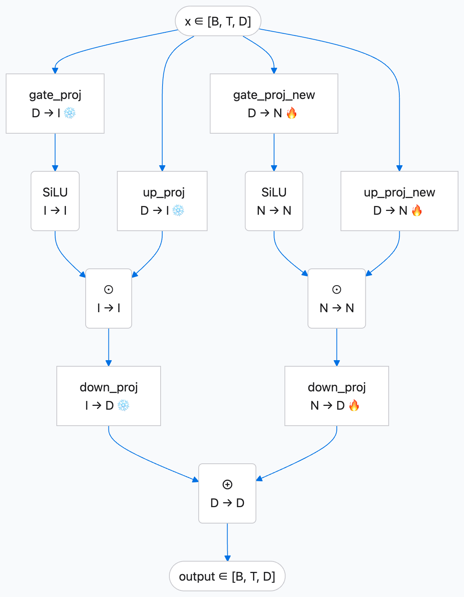

# Kadllm

**从理解用户到生成推荐：快手电商广告团队的 LLM4Rec 实践。**

[English](README.md) | 简体中文

我们是**快手电商广告召回团队**。我们正在探索如何把大语言模型的世界知识、语义理解能力和多源信息建模能力，真正用到广告推荐中：让模型理解用户的长期兴趣与深度需求，直接生成可能感兴趣的广告候选，并在工业场景的成本和时延约束下运行。

**Kadllm 是这项 LLM4Rec 实践中核心模型技术的社区版本。** 我们将其中的 **WideTuning 微调方法**和**GRBeam 共享前缀推理内核**提取为可独立使用的组件，希望帮助更多开发者将预训练语言模型用于生成式推荐，减少从模型适配到推理落地的工程成本。

## 为什么我们选择用大语言模型做推荐？

生成式推荐正在改变候选召回的方式：将广告或商品表示为一串简短的语义 ID（SID），模型便可以像生成文本一样，根据用户信息直接生成推荐对象。围绕这一目标，我们关注两条路线：一条是主要依靠用户行为数据、从头训练的生成式推荐模型；另一条是以预训练大语言模型为基座、面向推荐任务进行适配的 **LLM4Rec**。

我们持续投入 LLM4Rec，是因为它提供了两个值得挖掘的机会。

首先，**推荐可以利用行为日志之外的知识。** 大语言模型已有的世界知识和语义理解能力，为理解商品、内容和消费意图提供了基础；进一步融入电商业务知识，有望改善交互信号相对稀疏的中长尾用户与广告推荐。我们此前在 Align3GR 的两期实践中，已经观察到这条路线在中长尾场景中的价值。

其次，**用户兴趣可以由更长周期、更多领域的信息共同表达。** 广告点击之外，用户画像、内容偏好、电商加购和支付历史，以及多源异构行为，都可能帮助模型理解深度兴趣。LLM4Rec 为这些信息提供了统一建模的空间，也让推荐有机会减少对单一广告交互数据循环的依赖。

因此，在我们的实践中，从头训练的生成式推荐与 LLM4Rec 是优势互补的两条路线。这个项目的目标，是构建一个能够结合通用知识、电商知识与用户行为的 **电商广告 LLM4Rec 基座模型**，并验证它在真实召回场景中的价值。

## 从“能生成”到“能上线”，我们解决了什么？

将一个语言模型接上推荐数据，只是起点。真正落地时，我们遇到了四个彼此关联的问题：如何学习大量新 SID 而不过度扰动已有能力，哪些电商知识能够有效帮助推荐，如何融合多源用户信息，以及如何把推理成本降到线上可用的水平。

完整项目围绕这些问题，探索了 SID 与文本的语义对齐、协同关系与电商知识注入、将异构信息压缩成 Soft Token 的 Token Factory，以及面向短序列生成的专用推理。**Kadllm 聚焦其中最便于社区独立复用的两部分：模型如何训练，以及推理如何加速。**

### WideTuning：缓解 SID 适配中的灾难性遗忘



SID 适配需要模型学习大量新的 Token、语义对应关系和推荐关联，容易引发灾难性遗忘。WideTuning 正是为缓解这一问题而设计：冻结原有 FFN 分支，为新知识增加独立可训练通道，兼顾 SID 对齐与通用能力保持。

WideTuning 利用主流语言模型的 gated FFN 结构，在原有中间维度之外增加可训练通道。原分支保持冻结，新分支学习任务相关信息；新增输出投影零初始化，使扩展瞬间保持原函数。训练完成后，两部分可以合并为普通的加宽 dense MLP，不需要额外的专家路由器。

对使用者而言，这意味着可以在已有模型上直接安装扩展，独立训练新增参数，再合并部署。下文分别列出不同微调方式的 SID 对齐结果和通用 benchmark，检验新知识学习与能力保持；冻结原权重本身不构成训练后能力不变的保证。

### GRBeam：让几百条候选不再各自保存一份长上下文

推荐中的生成任务有一个鲜明特点：**输出很短，候选却很多。** 一个 SID 可能只有两三个 Token，但一次召回需要生成数百条候选。对于混合线性注意力与全注意力的模型，为每个 beam 维护、复制和重排状态，会带来明显的显存与执行开销。

我们的思路是：长前缀只计算并保存一次，各 beam 共享这份只读状态；解码时只重放各自很短的生成后缀。围绕这一执行方式，GRBeam 提供 Triton gated-delta、因果卷积和可选 FlashAttention 路径，并通过分组复用前缀、优化末步计算，进一步减少开销。

在随机 Qwen3.5-0.8B 模型、BF16、batch 32、前缀 1024、beam 256、输出 3 Token 的完整词表实验中，GRBeam 达到 **RTX 4090 单卡 16.94 请求/秒、H800 单卡 36.08 请求/秒**。另一组两级条件 SID 实验中，分组内核优化在 batch ≥ 8 时，相比原默认配置进一步降低 **6.6–10.4%** 的整批时延。详细对比和测量口径见下文；这些是特定工作负载下的性能结果，不代表随机模型具备推荐质量。

## 这项实践带来了什么？

在完整项目中，我们将模型适配、多源信息融合与推理优化结合，并通过 SID 生成和向量召回两条互补通路接入广告召回。

- **离线效果：** 语义与领域预训练结合 SFT，完整 SID Hit@128 从 **0.110 提升至 0.304**；另一组实验中，加入用户小传和电商行为信息后，该指标从 **0.288 提升至 0.335**。
- **生产吞吐：** 1.06B 模型、输入 400–5,000 Token、beam schedule 为 [256, 256, 512] 时，**8 张 RTX 4090 总计达到 340 请求/秒**。
- **线上收益：** 七天 A/B 实验报告，目标电商广告范围的**广告消耗提升 0.961%**，**商业化大盘消耗提升 0.427%**。

以上是完整业务系统的实验与生产结果，包含本仓库之外的数据、特征和服务优化，不能全部归因于某个独立模块。对我们而言，它们说明了将语言模型的知识能力、用户信息建模与专用推理联合设计的实践价值。

## 我们希望把什么带给社区？

Kadllm 提供可独立接入的 **WideTuning、GRBeam 共享前缀推理算子、模型适配器和 benchmark 脚本**。你可以只用 WideTuning 为自己的 gated MLP 增加容量，也可以只使用推理内核，评估不同 batch、beam、序列长度及后端组合的性能。

我们希望分享从真实业务问题中提炼出的技术，让更多人能够探索 LLM4Rec，也欢迎社区在更多模型、硬件和推荐任务上验证、改进这些组件。下面介绍具体的安装、接入方式和可复现的性能评估方法。

---

## WideTuning 的收益与微调方式对比

WideTuning 的目标是**缓解 SID 适配中的灾难性遗忘，在学习新 SID 语义的同时保持预训练模型的通用能力**。下面分别报告对齐效果和通用能力评测，两表使用同一 WideTuning 配置。

### 对齐数据集：不同微调方式的效果

| 微调方式 | L1 R@16 | L2 R@16 | L1 R@32 | L2 R@32 | L1 R@128 | L2 R@128 |
|---|---:|---:|---:|---:|---:|---:|
| WideTuning | 0.412 | **0.123** | **0.447** | **0.141** | **0.506** | **0.174** |
| LoRA (r=32) | 0.318 | 0.068 | 0.322 | 0.071 | 0.349 | 0.075 |
| LoRA (r=64) | — | — | — | — | 0.380 | 0.101 |
| 全量微调 | **0.416** | 0.107 | 0.420 | 0.110 | 0.435 | 0.117 |

L1/L2 对应原表的 `level1_recall` / `level2_recall`，R@K 表示 Recall@K。`—` 表示原图未报告数值。

### 通用 benchmark：适配后的能力保持

| 模型 / 微调方式 | MMLU | C-Eval valid | HellaSwag | WinoGrande | ARC-Challenge |
|---|---:|---:|---:|---:|---:|
| Qwen3.5-0.8B (原始基座) | 0.482 | 0.494 | 0.389 | 0.576 | 0.333 |
| LoRA (r=32) | 0.439 | 0.408 | 0.371 | 0.569 | 0.295 |
| WideTuning | 0.484 | 0.451 | 0.393 | 0.576 | 0.340 |

原图未提供全量微调和 LoRA (r=64) 的通用 benchmark 分数。两表未附完整训练预算、评测协议或方差，因此这里报告原始观测值，不作统计显著性结论。

WideTuning 在对齐表中的 L2 Recall@128 为 **0.174**，LoRA (r=32/r=64) 和全量微调分别为 **0.075 / 0.101 / 0.117**。同一配置在通用 benchmark 上的 MMLU 为 **0.484**（基座 0.482），C-Eval 为 **0.451**（基座 0.494）：它体现了学习新任务与能力保持的平衡，但不意味着所有能力都没有下降。

采用 WideTuning 的整体预训练方案还有以下离线结果。它们比较的是训练数据与阶段配置，**不是三种微调方法的单独对比**：

| Hit@128 | 直接 SFT | 双向语义对齐 → SFT | 双向对齐 + 协同关系 + 电商知识 → SFT |
|---|---:|---:|---:|
| SID 第一级 | 0.392 | 0.440 | **0.557** |
| SID 前两级 | 0.188 | 0.255 | **0.363** |
| 完整 SID | 0.110 | 0.197 | **0.304** |

完整 SID 相比直接 SFT 增加 **19.4 个百分点**。源报告没有将这一收益拆解为 WideTuning、语义对齐与领域任务各自的贡献。

## GRBeam 推理性能

**与 OneLA 分支相比，GRBeam 在完整词表实验中的整卡采样显存更低；在只 decode 一次的两级 SID 场景中，部分配置的 QPS 略高。** 例如 RTX 4090、beam 256、batch 32、前缀 512 时，分组优化后的 GRBeam 为 **76.14 QPS**，调优 OneLA 分支为 **75.74 QPS**（由下表平均时延换算）。两级 SID 实验整体性能接近，不能将局部微弱优势推广到所有形状；该实验的张量 allocated 显存峰值相同，与完整词表实验的整卡采样口径不同。

### 完整词表宽 beam 解码

所有路径使用相同随机 Qwen3.5-0.8B 权重（包含未使用视觉塔共约 853M 参数），BF16，batch **32**、前缀 **1024**、beam **256**、输出 **3**，均计算完整 **248,320 token 词表**。首个输出来自 prefill，随后执行两次 decode。

| GPU | 路径 | 整批时延，秒（95% CI） | 请求/秒 | 整卡采样峰值，GiB |
|---|---|---:|---:|---:|
| RTX 4090 | vLLM 0.19.0 原生 beam | 243.20 ± 9.80 | 0.13 | 20.17 |
| RTX 4090 | GRBeam，原始默认启动配置 | 1.889 ± 0.016 | 16.94 | 9.10 |
| RTX 4090 | OneLA 分支 | 1.575 ± 0.112 | 20.31 | 12.59 |
| H800 | vLLM 0.19.0 原生 beam | 204.93 ± 7.73 | 0.16 | 65.48 |
| H800 | GRBeam，原始默认启动配置 | 0.887 ± 0.002 | 36.08 | 9.33 |
| H800 | OneLA 分支 | 0.725 ± 0.002 | 44.13 | 12.82 |

Transformers 5.20.2 原生 beam 在该形状下两种 GPU 均 OOM。每配置三个独立进程，每进程预热三次、计时五次；置信区间基于进程均值。时延包含 prefill、decode、选束、同步和 CPU 输出转换。请求/秒 = batch / 平均时延，不是 token/s，也不是线上到达率容量。

vLLM 开启编译、CUDA Graph、chunked prefill 和前缀缓存，序列/token 调度预算为 256/8192，显存池比例为 0.8，跨调用缓存重置在计时外完成。其混合缓存块长 544 token，因此 512 token 前缀不能命中完整缓存块。较大差距包含原生 beam API 的重提交和调度成本，**不能据此对通用服务框架排名**。整卡采样显存包含预留分配及 vLLM 池，不等于活跃张量显存。

该形状下的 4090 全因子消融中，开启 gated-delta 加速后的几何时延比为 **0.248**（95% CI 0.240–0.257），对其余内核开关取平均；卷积和注意力的影响较小，且依赖形状。

论文中的 OneLA 是分支实现，未验证为作者官方发布版。此组原始启动配置未进行对称调参：OneLA 分支更快，GRBeam 整卡采样显存更低，不能据此作算法本身排名。输出增加到 7 Token（batch 4、前缀 1024、beam 256）时，GRBeam / OneLA 时延为 4090 上 767 / 475 ms、H800 上 442 / 284 ms，体现后缀重放随输出增长的成本。

### 逐内核收益：完整三因子消融

论文对 GDN、卷积、注意力做了完整的 2³ 开关组合实验。以下是在上述 RTX 4090 配置下，开启某个内核相对关闭它的**端到端几何时延比**，对其他两个开关取平均；不是单算子的执行时长，也不是可相加的收益。

| 加速内核 | 开启 / 关闭时延比（95% CI） | 平均时延变化 | 结论 |
|---|---:|---:|---|
| **Triton gated-delta（GDN）** | **0.248（0.240–0.257）** | **降低 75.2%**，约 4.03× 加速 | 该形状下的主要加速来源。 |
| Triton 因果卷积 | 0.986（0.964–1.009） | 降低 1.4% | 区间包含 1，不能确认稳定收益。 |
| FlashAttention 前缀/后缀注意力 | 1.005（0.965–1.045） | 增加 0.5% | 区间包含 1，该形状下没有明确加速。 |

这些数据说明应按工作负载选择内核，而非假设全部开启一定最快。下方 benchmark 支持单独开启和组合开启三个内核。

### Gated-delta 分组优化

另一组两级条件 SID 实验使用 RTX 4090、每级 4,096 token、beam 256，只执行一次后缀 decode。与 GRBeam 原默认配置相比，分组前缀复用和末步 readout 展开在 **batch ≥ 8 时降低整批时延 6.6–10.4%**。部分结果：

| 前缀 | Batch | 原配置，ms | 分组优化，ms（95% CI） | 调优 OneLA 分支，ms（95% CI） |
|---:|---:|---:|---:|---:|
| 512 | 8 | 98.4 ± 4.4 | 89.2 ± 13.5 | 88.9 ± 10.3 |
| 512 | 32 | 461.2 ± 6.8 | 420.3 ± 20.3 | 422.5 ± 11.9 |
| 1024 | 8 | 172.9 ± 8.6 | 158.8 ± 3.9 | 161.6 ± 15.2 |
| 1024 | 32 | 772.4 ± 17.2 | 720.1 ± 26.5 | 722.7 ± 5.9 |

每配置三轮独立进程，每路径至少预热 50 次、交错计时 30 次，启动参数按 batch 在正式评估前选定。条件 SID 的输出头与评分口径不同于下方完整词表脚本，因此该脚本不能复现此表；算子脚本测量的是底层分组算子，不是完整应用实验。

研究中的 FP32 固定历史对照最大绝对误差低于 **1.6e-5**。BF16 候选集合并非完全相同，有限 beam 剪枝可能放大小分数差异。随机权重结果验证的是执行行为，不代表预训练模型的召回质量。

单层 GDN 微基准中，调优的逐 beam 递推为 **0.430 ms**，分组复用与末步展开降至 **0.164 ms**，调优 OneLA 为 **0.158 ms**。对称调参后的全部 16 个端到端形状中，GRBeam 相对 OneLA 从快 2.6% 到慢 1.4%；15/16 个配对 95% 区间包含持平。各形状 allocated 显存峰值相同；这里的计量口径不同于上面的整卡采样显存。

## 生产推理优化的逐项收益

LR 还记录了完整业务推理栈的工程收益，补充说明各项优化的作用。**这些是生产报告中的观察，各项基线不同或未完整注明，不能相加，也不能与上面的受控实验混为一谈。** SID-only head、业务 Trie 和长度调度属于完整应用，并非本库提供的现成服务能力。

| 优化 | 核心作用 | LR 报告的收益 |
|---|---|---|
| Prefix-sharing Paged Attention | beam 共享前缀 KV | 相对报告中的 vLLM 方案，QPS 约 **20×**；显存显著降低。 |
| Stateless Decode | 冻结请求级 KV/SSM 前缀，重放短后缀，免去持久状态重排 | QPS **+10%**；显存减少原文记为“30G”（未明确 GB/GiB 及计量范围）。 |
| SID-only LM head | 只投影到占完整词表不足 9% 的 SID 词表 | QPS **+15%**；显存 **−15%**。 |
| 针对性内核融合 | 优化模型执行路径与 Triton 算子 | QPS **+10%**；未进一步拆分到单个算子。 |
| 张量 Trie 约束 | 在 GPU 上完成合法路径剪枝 | GPU 占空比提高，显存无明显增加；未给出独立百分比。 |
| 按序列长度分批 | 聚合相近长度请求，减少 padding | QPS **+10%**。 |

## 应用背景与线上收益

两个组件源自快手电商广告召回系统，该系统结合 SID 适配、紧凑的异构用户特征、SID 生成和向量召回。生产报告记录：**8 张 RTX 4090 总吞吐 340 请求/秒**，**1.06B** 模型、输入长度 **400–5,000**、beam schedule **[256, 256, 512]**。这一配置还包含本库之外的业务输出头、约束和调度。

七天线上实验报告以下相对变化：

| 指标 | 目标电商广告范围 | 商业化大盘 |
|---|---:|---:|
| 广告消耗 | **+0.961%** | **+0.427%** |
| 曝光 | +0.440% | +0.159% |
| 预期花费，购买次数口径 | +0.816% | +0.456% |
| 预期花费，净价值口径 | — | +0.525% |

这是集成系统的收益，不能单独归因于 WideTuning 或某个内核。源报告文本未提供置信区间。预期花费是内部汇总指标，不等于实际购买量或 GMV。本仓库只分发可复用模型组件与 benchmark，不包含业务数据、checkpoint 或生产流水线。

## 安装

Python 3.10+；声明的最低 PyTorch 版本为 2.2，实际验证使用了更新版本。

```bash
git clone https://github.com/Greek-Guardian/Kadllm.git
cd Kadllm
python -m pip install -e .
# NVIDIA CUDA 内核与 Qwen3.5 benchmark 依赖：
python -m pip install -e '.[cuda,benchmark]'
```

根据 PyTorch/CUDA 组合单独安装 [FlashAttention](https://github.com/Dao-AILab/flash-attention#installation-and-features)。CPU 导入不需要 Triton、Transformers 或 FlashAttention。benchmark 可选依赖固定 Transformers 5.20.2；vLLM 请使用独立环境及其兼容依赖。下文完整词表对比采用 vLLM 0.19.0。

## WideTuning

在 gated MLP 的中间维度增加独立分支：

```text
f(x) = down(act(gate(x)) * up(x))
     + extra_down(act(extra_gate(x)) * extra_up(x))
```

新增 `extra_down` 零初始化，扩展瞬间保持原函数。原参数与新增参数彼此独立，冻结原分支后，AdamW 权重衰减也不会更新它。对隐藏维度 `d`、新增宽度 `r` 的无偏置模块，新增参数量为 `3*d*r`。两个分支均参与计算；这是带输入相关门控的稠密容量扩展，没有显式专家路由器。

### 接入已有模型

```python
import torch
from kadllm import install_widetuning

# model 是已加载的 torch.nn.Module。
model.requires_grad_(False)
plan = {"model.layers.0.mlp": 256, "model.layers.1.mlp": 256}
manifest = install_widetuning(model, plan)
optimizer = torch.optim.AdamW(p for p in model.parameters() if p.requires_grad)
# 接下来使用自己的 forward、loss.backward() 和 optimizer.step()。
```

从模型 `named_modules()` 中选择真实路径，不依赖模型名称猜测。`install_widetuning` 只冻结所选 MLP 的原分支；其余参数需要如上单独冻结，或显式开启希望训练的参数。必须在安装新增分支**之后**创建优化器。

单个 MLP 或自定义投影名称：

```python
from kadllm import GatedMLPSpec, WideTuningMLP

expanded = WideTuningMLP(mlp, extra_width=256)
dense = expanded.to_dense()
# 自定义名称时传入 spec=GatedMLPSpec(
#     gate="w1", up="w3", down="w2", activation="activation")
```

`to_dense()` 将通道拼接回常规的三个投影，消除双分支执行开销；加宽后的 FLOPs 仍高于原始 MLP。保存 expansion manifest、spec、冻结设置和 `state_dict`；恢复时先在新基座上安装相同扩展。合并后的 checkpoint 需要同步更新模型各层宽度及配置，再调用模型加载器；目前不自动处理 `save_pretrained()` 重建。

支持普通 `nn.Linear` gate/up/down 投影。融合投影、量化、MoE 和分片模型需要额外适配。初始化函数保持是数学意义上的保证，合并可能改变浮点舍入。冻结原权重**不代表**新增分支训练后通用语言行为完全不变。

## GRBeam：共享前缀推理

```text
每个请求 prefill 一次 → 只读前缀状态
                             ↓
beam token 历史 → 重放短后缀 → 打分/选束
                             ↑
                       复用同一前缀
```

batch 为 `B`、beam 为 `W` 时，持久前缀状态保持 `B` 份，而不是 `B*W` 份。选取父 beam 时只重排 token 历史。加速 gated-delta 内核按请求读取初始状态，不写回每个 beam 的最终状态；卷积读取共享前缀窗口；全注意力通过 log-sum-exp 统计量合并前缀和因果后缀两部分。

重放以重复计算短后缀换取更少的状态搬运，适合短输出、宽 beam；输出变长后重放成本会上升。torch 参考实现可能分配 beam 级中间张量，不承诺与加速内核具有相同显存效率。

### 无需下载模型即可运行

```python
import torch
from kadllm import grbeam_search
from kadllm.adapters import ReferenceHybridLM

model = ReferenceHybridLM(vocab_size=32).eval()
prompts = torch.randint(0, 32, (2, 5))
with torch.inference_mode():
    result = grbeam_search(model, prompts, widths=[2, 3, 4])
print(result.tokens.shape)  # [2, 4, 3]
print(result.valid)         # 约束条件下各 beam 槽位是否有效
```

这是用于展示接入方式的微型随机模型。对已加载的 dense Qwen3.5 模型：

```python
from kadllm.adapters import Qwen35GRBeamAdapter

# Qwen3_5ForConditionalGeneration；eval 模式、单设备、无 padding 文本输入。
adapter = Qwen35GRBeamAdapter(
    model.model.language_model, model.lm_head,
    gdn_backend="triton", conv_backend="triton", attention_backend="flash_attn",
    gdn_triton_config=(16, 1, 1, 8),
)
with torch.inference_mode():
    result = grbeam_search(adapter, input_ids, widths=[256, 256])
```

`Qwen3_5ForCausalLM` 的 text model 参数应传 `model.model`。启动配置含义为 `(value_tile, warps, stages, beam_group)`，请针对硬件调参。分组前缀读取和末步 readout 展开是可选优化。适配器当前支持默认 RoPE、无 padding、纯文本 dense Qwen3.5。BF16 候选排序可能与原生推理不同，上线前需要验证自己的训练 checkpoint。

其他架构可实现 `GRBeamAdapter.prefill(input_ids)`，返回 `PrefillResult(logits[B,V], state)`，以及 `decode(history[B,W,T], state)`，返回 `[B,W,V]` logits。decode 必须从只读前缀重放完整后缀，不能修改前缀。也可直接调用 `kadllm.ops` 中的算子，张量布局见函数 docstring。

| 组件 | 通用路径 | 加速路径 | 反向传播 |
|---|---|---|---|
| Gated delta | PyTorch CPU/MPS/CUDA | Triton | 仅 torch |
| 因果卷积 | PyTorch，任意正卷积宽度 | Triton，宽度 4、SiLU、无 bias | 仅 torch |
| 前缀/后缀注意力 | PyTorch，GQA、前缀 mask | FlashAttention，无 padding 前缀 | 仅 torch |
| WideTuning | PyTorch | 常规 PyTorch CUDA | 支持 |

GRBeam 支持固定深度、逐步束宽和布尔 token 约束；不包含 EOS 提前结束、长度惩罚、采样或连续批处理。约束在完整词表 log probability 上屏蔽非法 token，不对合法子集重新归一化。

## 运行自己的 benchmark

### 单算子：无需 checkpoint

```bash
python benchmarks/grbeam_kernels.py --device cpu --ops gdn conv attention --output results/cpu.json
CUDA_VISIBLE_DEVICES=0 python benchmarks/grbeam_kernels.py --device cuda --dtype bf16 \
  --ops gdn conv attention --backends torch accelerated \
  --batches 1 8 --beams 32 256 --suffixes 1 2 --prefixes 512 1024 \
  --gdn-config 16 1 1 8 --output results/kernels.json
```

通过 `--ops`、张量维度、batch、beam、后缀和注意力前缀长度组合工作负载，参数见 `--help`。每个加速用例先与 torch 参考结果对照并检查前缀不变，再计时。JSON 保存原始时延样本、误差、形状、版本和 CUDA allocated 显存峰值。失败用例被记录且返回非零退出码，不会作为加速结果。CPU 数字仅作为本机基线。

### 整模型 beam 与内核消融

构造一份共享随机 checkpoint，所有后端使用**同一目录**：

```bash
mkdir -p models
curl -L --fail https://huggingface.co/Qwen/Qwen3.5-0.8B/resolve/main/config.json \
  -o models/config.json
python benchmarks/prepare_model.py --config models/config.json --original-config \
  --output models/qwen35-random
CUDA_VISIBLE_DEVICES=0 python benchmarks/grbeam.py --model models/qwen35-random \
  --backend flash --batches 1 8 16 32 --lengths 512 1024 --beam 256 --depths 2 3 \
  --warmups 3 --repeats 5 --output results/flash.json
```

省略 `--original-config` 可构造微型随机模型。准备过程不下载模型权重。请在单张空闲 GPU 上运行；beam 脚本要求整卡初始显存占用 ≤64 MiB。建议先用小 batch、小 beam；宽 beam 原生基线可能 OOM，或每次调用耗时数分钟。

| `--backend` | 后缀实现 |
|---|---|
| `torch` | 全部参考算子 |
| `gdn` / `conv` / `attn` | 仅开启对应加速算子 |
| `both` / `gdn_flash` / `conv_flash` | 对应两个算子组合 |
| `flash` | Triton GDN、卷积和 FlashAttention |
| `transformers` | 原生 Transformers beam search |
| `vllm` | 原生 vLLM beam search，使用独立环境 |
| `external` | 自定义 `--adapter-factory module:function`，返回 `(adapter, search)` |

用 `--gdn-config 16 1 1 8` 指定分组内核配置，`--cache-mode cold|warm` 区分跨调用缓存复用，`--order-seed` 可复现地打乱形状顺序。vLLM 0.19+ 可用 `--vllm-gdn-backend triton` 指定官方 Triton prefill 后端。请用不同输出文件启动多个独立进程，评估轮次间变化。beam 脚本检查候选数、唯一性并记录重复稳定性，不据此断言数值等价或召回质量。

## 许可证

Kadllm 原创代码采用 MIT；上游归属及适用条款见 [LICENSE](LICENSE)、[NOTICE](NOTICE) 和 [licenses](licenses)。Gated-delta 内核衍生自 Flash Linear Attention；Qwen3.5 适配器的层计算顺序参考 Apache-2.0 许可的 Transformers。FlashAttention 是可选外部依赖。
